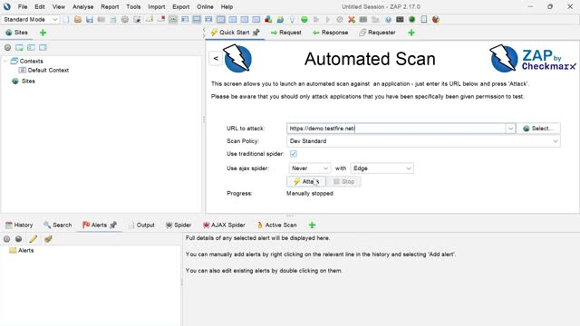
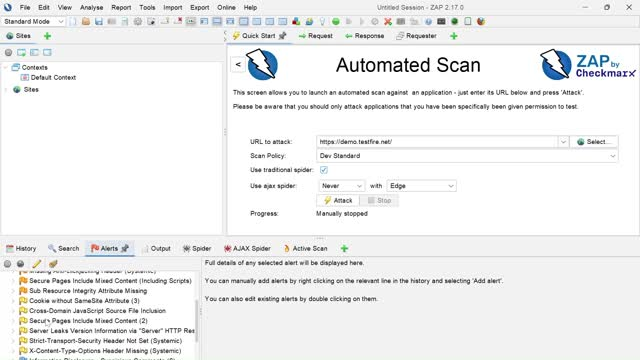
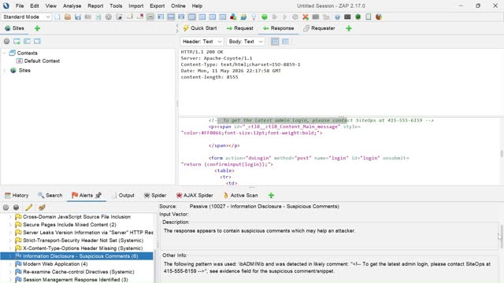

# ShopSphere | Cybersecurity Strategy & OWASP ZAP Demonstration

**Cybersecurity risk assessment · Security controls · Incident response · Web vulnerability scanning**

## Project overview

This Sacramento State **MIS 170 (Spring 2026)** academic group project developed a proposed security strategy for **ShopSphere**, a fictional mid-sized e-commerce business. The team examined risks related to weak authentication, sensitive information, web applications, security monitoring, and incident response, then presented technical and organizational recommendations.

As a practical supplement to the strategy report, the team demonstrated **OWASP ZAP** against the intentionally vulnerable **Altoro Mutual demonstration site** (`demo.testfire.net`). Screenshots below are taken from the recorded demonstration. This was a **learning exercise**, not a security assessment of ShopSphere's production infrastructure.

## Problem and business context

ShopSphere's hypothetical environment combines customer accounts, payment-related information, online ordering and reviews. The scenario identifies inadequate access controls, weak web application protection, and insufficient detection and response capabilities. The team's objective was to recommend a defensible, layered approach to reducing these risks.

## Proposed risk-based security strategy

| Area | Primary recommendations | Business objective |
| --- | --- | --- |
| Identity & access management | Multi-factor authentication, least-privilege role-based access, privileged access management, session limits | Reduce account takeover and improper access |
| Data protection | Encrypt data at rest and in transit, strong password hashing, protected key management | Safeguard customer and transaction data |
| Network and application security | Network segmentation, WAF, firewalls, intrusion prevention, vulnerability scanning | Reduce exposure to common attacks |
| Security monitoring | Centralized security logging and anomaly detection through SIEM | Improve incident visibility and response |
| Incident response & resilience | Documented incident response, backups, recovery objectives, tabletop exercises | Limit disruption and improve recovery |
| Governance & training | NIST-aligned risk management, PCI DSS awareness, employee education | Create sustainable security practices |

These are **proposals for a fictional scenario**, not controls verified as deployed.

## Hands-on OWASP ZAP demonstration

The screen recording shows the OWASP ZAP automated-scan interface, a scan of the Altoro Mutual demo site, ZAP's resulting alerts, and inspection of response-level evidence and suggested mitigations. Example observed alert categories include security header and cookie configuration issues and potential information disclosures.

**The recording does not establish successful exploitation of XSS or SQL injection**; the academic report discusses these risks, but the screenshot evidence here supports the narrower claim of scanning and reviewing alerts.

### Evidence from the recorded demonstration

**Scan setup and execution**

**Security alerts list**

**Alert details and response inspection**

See [demonstration notes](docs/zap-demonstration.md) for evidence limitations and responsible-testing context. The original full-length recording is not hosted in this repository; selected screenshots provide a concise reviewable artifact.

## Deliverables

- [MIS 170 group report (PDF)](report/MIS170_ShopSphere_Final_Report.pdf): analysis of identity management, cryptography, network security, risk/compliance, incident response and OWASP ZAP.
- [OWASP ZAP demonstration notes](docs/zap-demonstration.md): practical workflow and scope of observed evidence.
- [Security strategy summary](docs/security-strategy.md): concise mapping of risks to recommended controls.
- [Portfolio notes](docs/portfolio-notes.md): academic/team attribution and constraints.

## Methods and tools

**Security concepts:** IAM, MFA, RBAC, least privilege, encryption, SIEM, defense in depth, incident response, business continuity, NIST CSF and PCI DSS.

**Tool shown:** OWASP ZAP, an open-source web application security testing proxy.

## Academic project and attribution

Completed as a **five-member group project** at California State University, Sacramento. The original group report identifies Robert Velazquez, Rithik Kumar, Kamran Khan, Abrahim Zadran, and Jacob Boyd. The deliverables are collective academic work and are not represented as exclusively authored by one member. The report's historical AI-use statement applies to the original submission; this portfolio README and supplemental notes were written afterward.

## Limitations

- ShopSphere is a **hypothetical company**, not an actual business engagement.
- Recommended measures have **not** been deployed or measured in a production environment.
- The ZAP demonstration targets a separate **intentionally vulnerable training website**, not ShopSphere.
- Alerts are tool-generated indicators requiring validation; they are not proof that every flagged issue is exploitable.
- This project does not imply certification, professional penetration-testing experience, or production incident-response responsibility.
